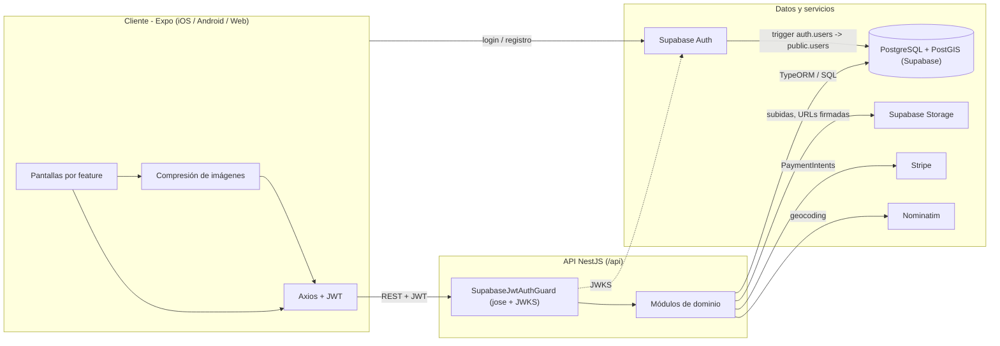
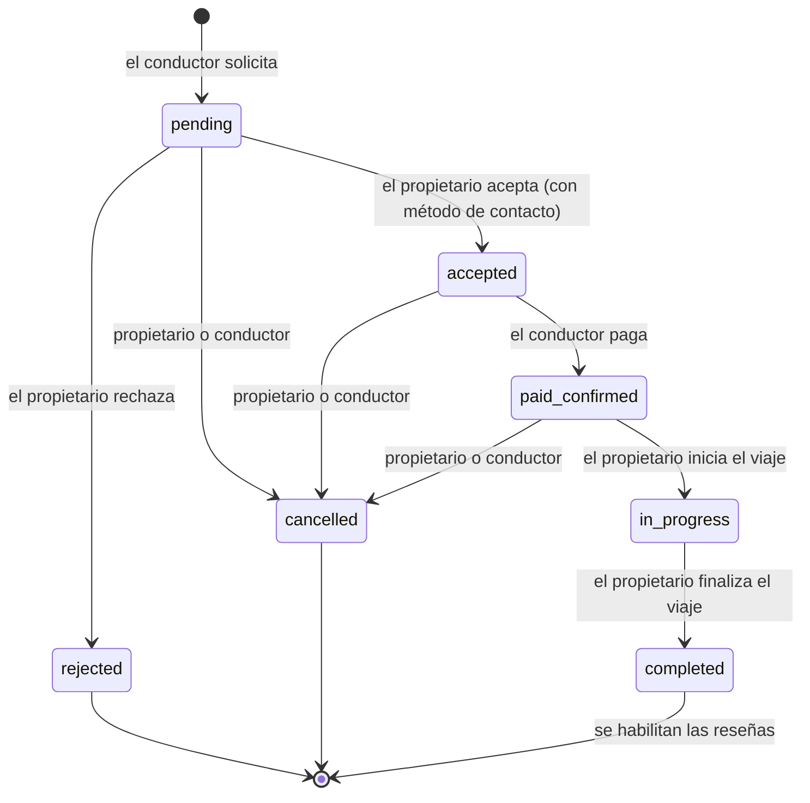

# LynkDrive

**Alquiler de coches entre particulares para quienes el rent-a-car tradicional deja fuera.**

LynkDrive permite a propietarios particulares alquilar su coche a conductores verificados de su zona. Funciona en iOS, Android y web desde un único código Expo, con una API NestJS sobre PostgreSQL/PostGIS.

> Trabajo Fin de Grado, Ingeniería Informática, Universidad de Alicante. Calificación: **9,5 / 10**.

[English version](../README.md)

## Motivación

La idea surge de algo que se veía en el campus cada semana: estudiantes que necesitan un coche para un fin de semana o para volver a casa y no pueden alquilarlo. La mayoría de rent-a-cars exige **tarjeta de crédito** para la fianza y muchos estudiantes solo tienen **tarjeta de débito**. Mientras tanto, muchos coches pasan días aparcados.

LynkDrive conecta a ambas partes. El propietario publica su coche con fotos, precio y ventanas de disponibilidad; el conductor encuentra coches cerca en un mapa, solicita la reserva y paga cuando el propietario la acepta. La entrega se documenta con checklists digitales de check-in y check-out, y al final ambos se valoran.

## Funcionalidades

**Cuentas y confianza**
- Registro e inicio de sesión con email y contraseña (Supabase Auth). App *auth-first*: sin sesión no hay pestañas ni funcionalidades.
- Perfil mínimo obligatorio en el registro (nombre, apellidos, teléfono).
- Avatar, DNI y carnet de conducir; las acciones transaccionales requieren `is_verified`.
- RGPD: exportar todos mis datos en JSON (`GET /api/users/me/export`) y borrar la cuenta (`DELETE /api/users/me`: anonimiza el perfil, borra los ficheros personales y el usuario de Supabase Auth; se rechaza si hay reservas activas).

**Propietarios (Mis Vehículos)**
- Alta de vehículos: marca, modelo, año, matrícula, descripción, precio/día, combustible, transmisión, plazas.
- Búsqueda de dirección mediante el endpoint de geocoding de la API (Nominatim), sin introducir coordenadas.
- Galería con foto principal y ventanas de disponibilidad.
- Activar/desactivar anuncios; borrado lógico.

**Conductores (Explorar)**
- Búsqueda por radio alrededor del usuario (PostGIS `ST_DWithin`) en lista y mapa (Leaflet en web, `react-native-maps` en nativo).
- Filtros: precio máximo, combustible, transmisión y plazas.
- Ficha con galería, resumen del propietario y calendario de disponibilidad en verde / naranja / gris (ventanas menos reservas confirmadas, con 2 h de margen para la entrega).

**Reservas (Mis Viajes)**
- Reserva en dos fases: solicitud, aceptación o rechazo del propietario y pago.
- Acciones según rol y estado, validadas en la API.
- Pagos con Stripe PaymentIntents y cobros a propietarios con Stripe Connect Express (onboarding, webhooks y reembolsos por cancelación), con modo prototipo si no hay clave de Stripe.
- Al aceptar una solicitud se rechazan automáticamente las `pending` solapadas del mismo coche, en una transacción con bloqueo de filas; los solapes incluyen 2 h de margen para la entrega.
- Checklists de check-in y check-out (kilometraje, combustible, notas y fotos en bucket privado).
- Valoraciones cruzadas (1 a 5 estrellas + comentario) al completar el viaje.

## Capturas

Las capturas y el GIF de demo están en `docs/screenshots/`; la lista de ficheros está en [screenshots/README.md](screenshots/README.md) y se muestran en el [README principal](../README.md#screenshots).

## Arquitectura

El cliente nunca accede a la base de datos. Supabase se usa como infraestructura gestionada (Postgres, Auth, Storage) y toda la lógica de negocio vive en la API NestJS.



## Ciclo de vida de una reserva

Extraído de `validateStatusTransition` en `apps/api/src/bookings/bookings.service.ts` y de `apps/api/src/payments/payments.service.ts`:



No se puede cancelar una reserva una vez pasada su fecha de inicio; solo el conductor puede pagar, y solo desde `accepted`.

## Decisiones técnicas clave

- **Supabase como DBaaS, no como BaaS.** Se usan Postgres, Auth y Storage, pero no la API REST autogenerada ni RLS públicas. Toda petición pasa por NestJS: validaciones, propiedad y transiciones en un único sitio.
- **Snapshot de precio.** La reserva guarda `price_per_day_at_booking`, `platform_fee` y `total_price` al crearse (días redondeados hacia arriba, mínimo uno). Cambiar el precio después no afecta a reservas existentes.
- **Solicitudes solapadas.** Las `pending` no bloquean el calendario. Al crear una solicitud, la API devuelve `409` si solapa con una reserva `accepted`, `paid_confirmed`, `in_progress` o `completed`, y exige que caiga dentro de una ventana de disponibilidad. La regla de diseño de rechazar automáticamente las demás `pending` solapadas al aceptar una todavía no está implementada (ver hoja de ruta).
- **Búsqueda espacial con PostGIS.** `vehicles.location` es `GEOMETRY(Point, 4326)` con índice GiST; la búsqueda usa `ST_DWithin` sobre `geography` para trabajar en metros reales. El siguiente paso es un índice de expresión sobre `location::geography`.
- **Ficheros privados con URLs firmadas.** DNI, carnet y fotos de checklist van a buckets privados; la API sube con la service role key y devuelve URLs firmadas temporales (por defecto 3600 s).
- **Compresión en cliente.** Antes de subir, la app convierte a JPEG, redimensiona (1024 px avatar, 1920 px resto) y baja la calidad hasta 500 KB (avatar) o 2 MB (resto); si no lo consigue, cancela la subida.
- **Monorepo con tipos compartidos.** npm workspaces con API, app y `packages/shared` (`BookingStatus`, `FuelType`, `Transmission`, DTOs de vehículo). Hoy la API y el cliente replican esos tipos; importarlos directamente está en la hoja de ruta.
- **Otras.** UTC en almacenamiento y lógica (Europe/Madrid en la UI), borrado lógico, `ON DELETE RESTRICT` en reservas y `TYPEORM_SYNCHRONIZE=false` fuera de local.

## Modelo de datos

Ocho tablas: `users`, `vehicles`, `vehicle_images`, `vehicle_availability_windows`, `bookings`, `booking_checklists`, `checklist_images` y `reviews`. Diagrama ER en el [README principal](../README.md#data-model) y SQL completo en [data-model.md](data-model.md).

## Puesta en marcha

Requisitos: Node.js 18 o superior, un proyecto de Supabase (Auth y Storage con los buckets `vehicles` y `avatars` públicos y `documents` y `checklists` privados), Docker si se quiere Postgres local y, opcionalmente, una clave de test de Stripe.

```bash
git clone https://github.com/aadl6-ua/lynkdrive.git
cd lynkdrive
npm install

cp apps/api/.env.example apps/api/.env
cp apps/mobile/.env.example apps/mobile/.env

# Postgres + PostGIS local (coincide con DATABASE_URL de .env.example)
docker compose -f infra/docker/docker-compose.yml up -d

# Aplicar migraciones de infra/db/migrations (la primera es el esquema base, idempotente)
npm run db:migrate:remote

# API y Expo a la vez
npm run dev
# o por separado
npm run dev:api
npm run dev:mobile
```

- Salud de la API: <http://localhost:3000/api/health>
- En la terminal de Expo: `w` para web, `i` para iOS, `a` para Android o QR con Expo Go.
- Emulador Android: `EXPO_PUBLIC_API_URL=http://10.0.2.2:3000/api`. Dispositivo físico: IP local del ordenador.
- La migración de sincronización de usuarios crea un trigger sobre `auth.users`, así que está pensada para la base de datos de Supabase.

Las variables de entorno de la API y de la app están documentadas en el [README principal](../README.md#environment-variables).

## Pruebas

- Tests unitarios (Jest, API): máquina de estados y precios de reservas, solapes y margen de 2 h, rechazo automático de solapadas, checklists, reseñas, subidas (con validación del contenido real de la imagen), guard JWT, webhooks de Stripe y exportación/borrado de cuenta. `npm run test`.
- Tests e2e de la API contra Postgres + PostGIS local (el esquema se recrea en cada ejecución; no apuntar nunca a Supabase): `npm run test:e2e` con `TEST_DATABASE_URL`.
- CI en GitHub Actions: lint, typecheck, build, tests unitarios y e2e en cada push y PR a `dev` y `main`.

Scripts de smoke (bash + curl + node) contra la API en marcha:

- `scripts/get_supabase_tokens.sh`: inicia sesión con dos usuarios de prueba y muestra los `export` de `OWNER_TOKEN` y `DRIVER_TOKEN`.
- `scripts/smoke_bookings.sh`: salud, `/users/me` y transiciones principales de reservas.
- `scripts/smoke_payments_checklists_reviews.sh`: flujo completo (vehículo, disponibilidad, reserva aceptada, pago, checklists, imágenes, finalización y reseñas). Funciona con Stripe real y en modo prototipo.
- `scripts/smoke_vehicle_images_availability.sh`: imágenes y disponibilidad; usa `OWNER_TOKEN`, comprueba el 401 sin token y borra su vehículo de prueba.

```bash
BASE_URL=http://localhost:3000/api ./scripts/smoke_bookings.sh
```

## Hoja de ruta

- Panel "Mis ingresos".
- Usar `@lynkdrive/shared` desde la API y la app.
- Chat, emails transaccionales, notificaciones push y backoffice.
- Verificación de identidad fuerte (eIDAS / DNIe / Cl@ve).

## Licencia

Todavía no se ha elegido una licencia open source, así que todos los derechos están reservados por el autor. El código se publica con fines académicos y de portfolio; para reutilizarlo, contacta con el autor.

## Autor

**Álvaro Andrés De Lamo**
Ingeniería Informática, Universidad de Alicante.
GitHub: [@aadl6-ua](https://github.com/aadl6-ua)
