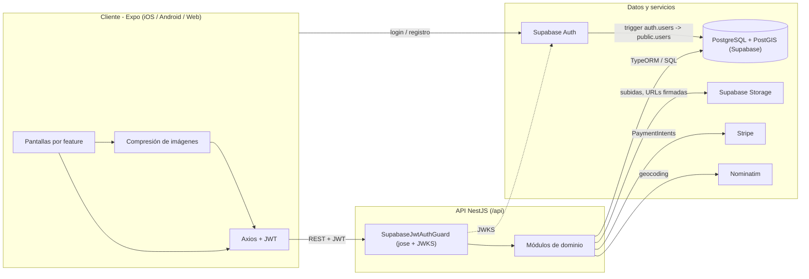
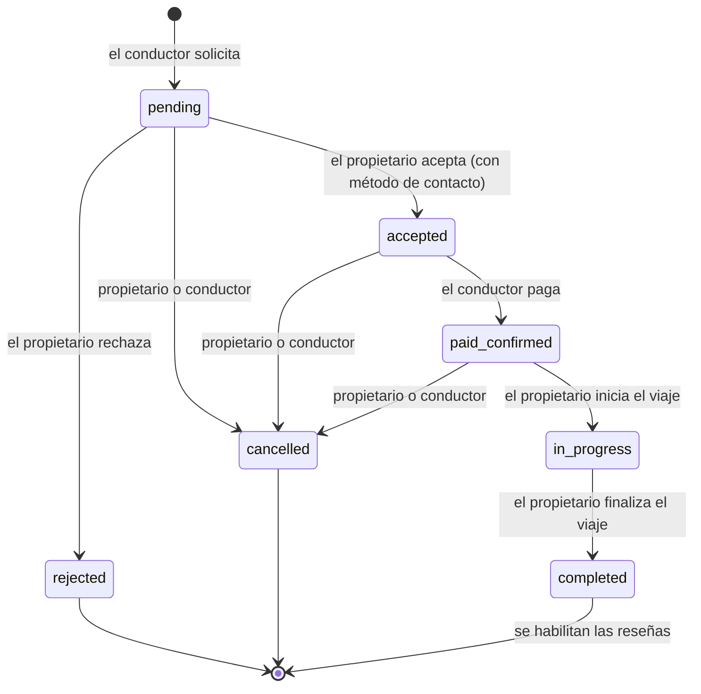

# LynkDrive

**Alquiler de coches entre particulares para quienes el rent-a-car tradicional deja fuera.**

LynkDrive permite a propietarios particulares alquilar su coche a conductores verificados de su zona. Funciona en iOS, Android y web desde un único código Expo, con una API NestJS sobre PostgreSQL/PostGIS.

> Trabajo Fin de Grado, Ingeniería Informática, Universidad de Alicante. Calificación: **9,5 / 10**.

[English version](../README.md)

## Motivación

La idea surge de algo que se veía en el campus cada semana: estudiantes que necesitan un coche para un fin de semana o para volver a casa y no pueden alquilarlo. La mayoría de rent-a-cars exige **tarjeta de crédito** para la fianza y muchos estudiantes solo tienen **tarjeta de débito**. Mientras tanto, muchos coches pasan días aparcados.

LynkDrive conecta a ambas partes. El propietario publica su coche con fotos, precio y ventanas de disponibilidad; el conductor encuentra coches cerca en un mapa, solicita la reserva y paga cuando el propietario la acepta. La entrega se documenta con checklists digitales de check-in y check-out, y al final ambos se valoran.

## Funcionalidades

**Cuentas y confianza**
- Registro e inicio de sesión con email y contraseña (Supabase Auth). App *auth-first*: sin sesión no hay pestañas ni funcionalidades.
- Perfil mínimo obligatorio en el registro (nombre, apellidos, teléfono).
- Avatar, DNI y carnet de conducir; las acciones transaccionales requieren `is_verified`.
- RGPD: exportar todos mis datos en JSON (`GET /api/users/me/export`) y borrar la cuenta (`DELETE /api/users/me`: anonimiza el perfil, borra los ficheros personales y el usuario de Supabase Auth; se rechaza si hay reservas activas).

**Propietarios (Mis Vehículos)**
- Alta de vehículos: marca, modelo, año, matrícula, descripción, precio/día, combustible, transmisión, plazas.
- Búsqueda de dirección mediante el endpoint de geocoding de la API (Nominatim), sin introducir coordenadas.
- Galería con foto principal y ventanas de disponibilidad.
- Activar/desactivar anuncios; borrado lógico.
- Panel "Mis ingresos" (`GET /api/earnings/mine`): neto del mes actual, mes anterior, año y total (calendario Europe/Madrid), desglose por vehículo y por reserva (bruto, comisión, neto, estado de reserva y de pago al propietario) y filtro opcional `from`/`to`.

**Conductores (Explorar)**
- Búsqueda por radio alrededor del usuario (PostGIS `ST_DWithin`) en lista y mapa (Leaflet en web, `react-native-maps` en nativo).
- Filtros: precio máximo, combustible, transmisión y plazas.
- Ficha con galería, resumen del propietario y calendario de disponibilidad en verde / naranja / gris (ventanas menos reservas confirmadas, con 2 h de margen para la entrega).

**Reservas (Mis Viajes)**
- Reserva en dos fases: solicitud, aceptación o rechazo del propietario y pago.
- Acciones según rol y estado, validadas en la API.
- Pagos con Stripe PaymentIntents y cobros a propietarios con Stripe Connect Express (onboarding, webhooks y reembolsos por cancelación), con modo prototipo si no hay clave de Stripe.
- Al aceptar una solicitud se rechazan automáticamente las `pending` solapadas del mismo coche, en una transacción con bloqueo de filas; los solapes incluyen 2 h de margen para la entrega.
- Checklists de check-in y check-out (kilometraje, combustible, notas y fotos en bucket privado).
- Valoraciones cruzadas (1 a 5 estrellas + comentario) al completar el viaje.
- Notificaciones push (Expo) a la otra parte en cada cambio de la reserva (nueva solicitud, aceptada, rechazada, pagada, cancelada, iniciada, completada) y cuando se puede dejar reseña; al tocarla se abre la reserva en Mis Viajes.
- Chat interno por reserva entre conductor y propietario (sin compartir teléfono): contador de no leídos en Mis Viajes, confirmación de lectura, reintento de envíos fallidos, notificación push por cada mensaje nuevo (al tocarla se abre la conversación) y polling solo mientras la conversación está abierta.

**Backoffice de administración (web)**
- Panel de métricas: usuarios, vehículos, reservas por estado e ingresos (volumen cobrado, comisión estimada y últimos seis meses).
- Usuarios: búsqueda, revisión de documentos con URLs firmadas de caducidad corta, verificar o retirar verificación y bloquear o desbloquear (una cuenta bloqueada recibe `403` en toda la API y queda baneada en Supabase Auth).
- Vehículos: activar y desactivar anuncios (si lo desactiva un admin, el propietario no puede reactivarlo). Reseñas: ocultar y volver a mostrar con motivo de moderación (las ocultas no cuentan en la valoración).
- Reservas: historial completo de estados (registrado por un trigger en la BD), fotos de los checklists mediante URLs firmadas y el chat de la reserva en solo lectura (para resolver incidencias).
- Incidencias: crear, listar, cambiar de estado y añadir notas internas.

## Capturas

Las capturas y el GIF de demo están en `docs/screenshots/`; la lista de ficheros está en [screenshots/README.md](screenshots/README.md) y se muestran en el [README principal](../README.md#screenshots).

## Arquitectura

El cliente nunca accede a la base de datos. Supabase se usa como infraestructura gestionada (Postgres, Auth, Storage) y toda la lógica de negocio vive en la API NestJS.



## Ciclo de vida de una reserva

Extraído de `validateStatusTransition` en `apps/api/src/bookings/bookings.service.ts` y de `apps/api/src/payments/payments.service.ts`:



No se puede cancelar una reserva una vez pasada su fecha de inicio; solo el conductor puede pagar, y solo desde `accepted`.

## Decisiones técnicas clave

- **Supabase como DBaaS, no como BaaS.** Se usan Postgres, Auth y Storage, pero no la API REST autogenerada ni RLS públicas. Toda petición pasa por NestJS: validaciones, propiedad y transiciones en un único sitio.
- **Snapshot de precio.** La reserva guarda `price_per_day_at_booking`, `platform_fee` y `total_price` al crearse (días redondeados hacia arriba, mínimo uno). Cambiar el precio después no afecta a reservas existentes.
- **Solicitudes solapadas.** Las `pending` no bloquean el calendario. Al crear una solicitud, la API devuelve `409` si solapa con una reserva `accepted`, `paid_confirmed`, `in_progress` o `completed`, y exige que caiga dentro de una ventana de disponibilidad. La regla de diseño de rechazar automáticamente las demás `pending` solapadas al aceptar una todavía no está implementada (ver hoja de ruta).
- **Búsqueda espacial con PostGIS.** `vehicles.location` es `GEOMETRY(Point, 4326)` con índice GiST; la búsqueda usa `ST_DWithin` sobre `geography` para trabajar en metros reales. El siguiente paso es un índice de expresión sobre `location::geography`.
- **Ficheros privados con URLs firmadas.** DNI, carnet y fotos de checklist van a buckets privados; la API sube con la service role key y devuelve URLs firmadas temporales (por defecto 3600 s).
- **Compresión en cliente.** Antes de subir, la app convierte a JPEG, redimensiona (1024 px avatar, 1920 px resto) y baja la calidad hasta 500 KB (avatar) o 2 MB (resto); si no lo consigue, cancela la subida.
- **Monorepo con contratos compartidos.** npm workspaces con API, app y `packages/shared` (`@lynkdrive/shared`), que define el contrato de la API: enums de reservas, checklists, vehículos y subidas, y la forma de peticiones y respuestas de vehículos, reservas, checklists, reseñas, pagos y usuarios. Las respuestas son genéricas en el tipo de fecha: los DTOs de la API las implementan con `Date` y la app las consume con strings ISO. Ambas apps usan solo `import type`, así que no cambia nada en runtime; el paquete se compila a `dist/` con su script `prepare` al hacer `npm install`/`npm ci`.
- **Notificaciones push no bloqueantes.** El dispositivo registra su token Expo con `POST /api/push-tokens` y lo da de baja al cerrar sesión (`DELETE /api/push-tokens/:token`). La API envía por la Expo Push API (HTTP, sin SDK) en segundo plano: si falla solo registra un aviso sin datos personales, y borra los tokens que Expo marca como `DeviceNotRegistered`. Los tokens se incluyen en la exportación RGPD y se borran con la cuenta.
- **Chat de reservas sin websockets.** Los mensajes se guardan en `booking_messages` y se sirven con endpoints REST bajo `/api/booking-messages` (JWT, solo los dos participantes):
    - `GET /booking-messages?bookingId=&after=&before=&limit=`: página en orden cronológico (`limit` 1-100, por defecto 50). Sin cursor, los últimos; con `after=<idMensaje>`, solo los nuevos (polling); con `before=<idMensaje>`, los anteriores. Devuelve `{ messages, hasMore, canSend, sendBlockedReason }`.
    - `POST /booking-messages` `{ bookingId, body }` (sin espacios sobrantes, 1-2000 caracteres; `403` fuera de plazo).
    - `POST /booking-messages/read` `{ bookingId }`: marca como leídos los recibidos y devuelve `{ updated }`.
    - `GET /booking-messages/unread`: `{ total, bookings: [{ bookingId, unread }] }`.

  La app consulta cada 4 s con `after` solo mientras la conversación está abierta y en primer plano: suficiente para coordinar la entrega y sin conexiones persistentes en el plan gratuito de Render. Se puede escribir en `pending`, `accepted`, `paid_confirmed` e `in_progress` y hasta 7 días después de pasar a `completed` (según `booking_status_history`); las rechazadas, canceladas o con la otra parte dada de baja quedan en solo lectura. Límite de 20 mensajes por minuto, push en segundo plano a la otra parte (título y vista previa de 120 caracteres, nunca en logs) y, por RGPD, los mensajes propios se exportan y se borran con la cuenta.
- **Otras.** UTC en almacenamiento y lógica (Europe/Madrid en la UI), borrado lógico, `ON DELETE RESTRICT` en reservas y `TYPEORM_SYNCHRONIZE=false` fuera de local.

## Modelo de datos

Ocho tablas de negocio: `users`, `vehicles`, `vehicle_images`, `vehicle_availability_windows`, `bookings`, `booking_checklists`, `checklist_images` y `reviews`, más las del backoffice: `booking_status_history`, `incidents` e `incident_notes`, y `push_tokens` y `booking_messages` (chat de reservas). Diagrama ER en el [README principal](../README.md#data-model) y SQL completo en [data-model.md](data-model.md).

## Puesta en marcha

Requisitos: Node.js 18 o superior, un proyecto de Supabase (Auth y Storage con los buckets `vehicles` y `avatars` públicos y `documents` y `checklists` privados), Docker si se quiere Postgres local y, opcionalmente, una clave de test de Stripe.

```bash
git clone https://github.com/aadl6-ua/lynkdrive.git
cd lynkdrive
npm install

cp apps/api/.env.example apps/api/.env
cp apps/mobile/.env.example apps/mobile/.env

# Postgres + PostGIS local (coincide con DATABASE_URL de .env.example)
docker compose -f infra/docker/docker-compose.yml up -d

# Aplicar migraciones de infra/db/migrations (la primera es el esquema base, idempotente)
npm run db:migrate:remote

# API y Expo a la vez
npm run dev
# o por separado
npm run dev:api
npm run dev:mobile
```

- Salud de la API: <http://localhost:3000/api/health>
- En la terminal de Expo: `w` para web, `i` para iOS, `a` para Android o QR con Expo Go.
- Emulador Android: `EXPO_PUBLIC_API_URL=http://10.0.2.2:3000/api`. Dispositivo físico: IP local del ordenador.
- La migración de sincronización de usuarios crea un trigger sobre `auth.users`, así que está pensada para la base de datos de Supabase.

Las variables de entorno de la API y de la app están documentadas en el [README principal](../README.md#environment-variables).

## Backoffice de administración

`apps/admin` es una SPA sencilla con Vite + React + TypeScript para operar la plataforma. Inicia sesión con las mismas cuentas de Supabase Auth que la app y solo consume la API bajo `/api/admin`, protegida por `AdminGuard`: JWT de Supabase válido **y** `users.is_admin = true` en la base de datos (el rol nunca se toma de los claims del token).

**1. Aplicar la migración.** `infra/db/migrations/202610310900_admin_backoffice.sql` (idempotente) añade `users.is_admin`, `users.blocked_at`, `vehicles.disabled_by_admin_at`, las columnas de moderación de reseñas, la tabla `booking_status_history` con su trigger y las tablas `incidents` e `incident_notes`:

```bash
npm run db:migrate:remote
```

**2. Nombrar un admin.** La cuenta debe existir (registro previo en la app). El script usa `DATABASE_URL` del entorno o de `apps/api/.env`:

```bash
npm run admin:set -- admin@ejemplo.com            # conceder
npm run admin:set -- admin@ejemplo.com --revoke   # retirar
```

SQL equivalente:

```sql
UPDATE public.users SET is_admin = TRUE
WHERE id = (SELECT id FROM auth.users WHERE email = 'admin@ejemplo.com');
```

**3. Configurar y arrancar.**

```bash
cp apps/admin/.env.example apps/admin/.env   # rellenar las variables de abajo
npm run dev:admin                             # http://localhost:5174
npm run build -w @lynkdrive/admin             # build estática en apps/admin/dist (Vercel, Netlify...)
```

| Variable | Ejemplo | Uso |
|---|---|---|
| `VITE_API_URL` | `http://localhost:3000/api` | URL base de la API NestJS |
| `VITE_SUPABASE_URL` | `https://<ref>.supabase.co` | Supabase Auth |
| `VITE_SUPABASE_ANON_KEY` | anon key | Cliente de Supabase (clave pública, la misma que la app) |

- Si la API define `CORS_ORIGINS`, hay que añadir el origen del panel (por ejemplo `http://localhost:5174`).
- Para ver DNI, carnets y fotos de checklists la API necesita `SUPABASE_SERVICE_ROLE_KEY`; los enlaces caducan según `SUPABASE_SIGNED_URL_TTL_SECONDS` (máximo 1 hora).
- El bloqueo se aplica en 30 segundos como mucho (el guard JWT cachea brevemente el estado) y, con service role configurada, el usuario también queda baneado en Supabase Auth y no puede renovar la sesión.
- La sesión del panel se guarda en `sessionStorage`: se cierra al cerrar la pestaña.
- Endpoints: ver la tabla del [README principal](../README.md#admin-back-office).

### Notificaciones push

- API: `PUSH_NOTIFICATIONS_ENABLED` (por defecto activas; `false` las desactiva) y `EXPO_ACCESS_TOKEN` (opcional, solo si el proyecto de Expo tiene activada la seguridad reforzada de push).
- App: `EXPO_PUBLIC_EAS_PROJECT_ID` (opcional; si no, se lee `extra.eas.projectId` de la configuración).
- Son opcionales: en web, simuladores, Expo Go de Android (sin push remotas desde SDK 53) o sin proyecto EAS la app funciona igual y la tarjeta de Perfil no aparece. En un iOS/Android físico hace falta una development build o una build de EAS (`eas build`) con credenciales de push (clave APNs en iOS, cuenta de servicio FCM V1 en Android; `eas credentials`). El permiso solo se pide al pulsar "Activar notificaciones" en Perfil.

## Pruebas

- Tests unitarios de la API (Jest + `@nestjs/testing`, `apps/api/src/**/*.spec.ts`): máquina de estados y precios de reservas, solapes y margen de 2 h, rechazo automático de solapadas, checklists, reseñas, subidas (con validación del contenido real de la imagen), guards JWT y de admin, servicio del backoffice, webhooks de Stripe, chat de reservas (acceso, plazo para escribir, cursores, no leídos y push), exportación/borrado de cuenta y que los enums de validación coinciden con `@lynkdrive/shared`.
- Tests unitarios de la app (Jest con preset `jest-expo`, `apps/mobile/src/**/__tests__/*.test.ts`): formato de fechas en Europe/Madrid y EUR (con cambios de hora), días facturables, helpers de estado de reserva, mensajes de error de la API, verificación, compresión de imágenes (`prepareUploadImage` con `expo-image-manipulator` y `fetch` mockeados), resolución de URLs de Storage, reglas de disponibilidad del calendario (colchón de 2 h, `pending` no bloquea), helpers del chat (unión de páginas del polling, separadores de día en Europe/Madrid y agrupación) y stores de Zustand con Axios y Supabase mockeados. Se ejecutan con la zona horaria del dispositivo en `America/New_York` para comprobar que la presentación en Madrid no depende del dispositivo.
- `npm run test` ejecuta los de la API y los de la app (`npm run test -w @lynkdrive/mobile` solo la app).
- Tests e2e de la API (flujo de reservas, chat, ingresos y backoffice) contra Postgres + PostGIS local (el esquema se recrea en cada ejecución; no apuntar nunca a Supabase): `npm run test:e2e` con `TEST_DATABASE_URL`.
- CI en GitHub Actions: lint, typecheck, build (incluidos el panel admin y `expo export --platform web`), tests unitarios de API y app y e2e en cada push y PR a `main`, `dev` e `integracion`.

Scripts de smoke (bash + curl + node) contra la API en marcha:

- `scripts/get_supabase_tokens.sh`: inicia sesión con dos usuarios de prueba y muestra los `export` de `OWNER_TOKEN` y `DRIVER_TOKEN`.
- `scripts/smoke_bookings.sh`: salud, `/users/me` y transiciones principales de reservas.
- `scripts/smoke_payments_checklists_reviews.sh`: flujo completo (vehículo, disponibilidad, reserva aceptada, pago, checklists, imágenes, finalización y reseñas). Funciona con Stripe real y en modo prototipo.
- `scripts/smoke_vehicle_images_availability.sh`: imágenes y disponibilidad; usa `OWNER_TOKEN`, comprueba el 401 sin token y borra su vehículo de prueba.

```bash
BASE_URL=http://localhost:3000/api ./scripts/smoke_bookings.sh
```

## Hoja de ruta

- Verificación de identidad fuerte (eIDAS / DNIe / Cl@ve).

## Licencia

Todavía no se ha elegido una licencia open source, así que todos los derechos están reservados por el autor. El código se publica con fines académicos y de portfolio; para reutilizarlo, contacta con el autor.

## Autor

**Álvaro Andrés De Lamo**
Ingeniería Informática, Universidad de Alicante.
GitHub: [@aadl6-ua](https://github.com/aadl6-ua)
